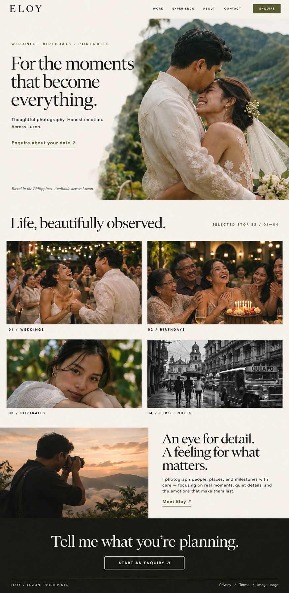

# EloyWebsite
Photography portfolio for Eloy

## Homepage visual concept

An editorial portfolio direction for wedding, birthday, and portrait photography across Luzon, with street photography as a creative collection. Warm ivory, elegant typography, large photographs, and clear enquiry prompts support the enquiry → consultation → tailored proposal journey.

This is a design mockup, not an implemented website. All photographs in the concept are generated placeholders, including the photographer portrait; they are not Eloy's actual work. Replace them with approved original photographs before launch.

## Planned website

- Home, About, Services, Gallery, and Contact pages.
- Services: Weddings, Birthdays & Celebrations, and Portraits, each with tailored quotes.
- Gallery categories: Weddings, Birthdays, Portraits, and Street Notes. Birthdays have a dedicated image and category in the homepage concept.
- Enquiry service choices include birthdays, with optional guest count and event details.
- Privacy Notice, Terms & Conditions, and Copyright & Image Usage pages.
- Responsive layouts, accessible gallery interactions, restrained animation, and optimised images.
- Supabase for portfolio data, image storage, administrator authentication, and private enquiries.
- Enquiry → consultation → tailored proposal; payments, calendar booking, contracts, and private client galleries are future phases.

Supabase is the planned backend. A separate frontend deployment is required to make the website accessible online. No application code or Supabase integration has been implemented yet.
